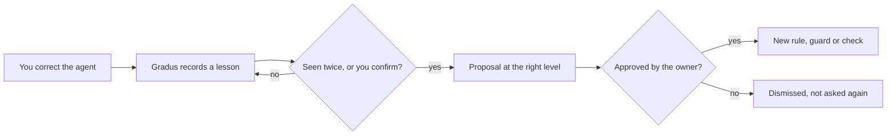

<div align="center">

# Gradus

### Every agent climbs the same steps.

**Layered, governed rules for AI coding agents — from your company's policies down to your own habits.**

[](docs/design/gradus-design.md)
[](LICENSE)
[](#which-agents)

[Quick start](#quick-start-personal-setup) · [The problem](#the-monday-morning-problem) · [The idea](#the-idea-a-pyramid-of-rules) · [Before / after](#before--after) · [What we believe](#what-we-believe) · [How it works](#how-it-works) · [Status](#status-and-roadmap) · [FAQ](#faq) · [Design](docs/design/gradus-design.md)

</div>

> [!NOTE]
> **Phase 3 Organization (`v0.4.1`) is available.** Install `gradusctl` as a single static binary and govern personal, team, business-unit, and organization repositories across Claude Code, Antigravity, Codex, GitHub Copilot, OpenCode, chat skill bundles, and MCP (`gradusctl serve --mcp`) — with conditional profile overlays, compliance framework mapping & audit export, model capability-tier policies, enterprise `managed-settings.json`, process maturity assessment (`gradusctl assess`), and optional commit attribution trailers. The living design specification (Design 1.2) lives in [`docs/design/gradus-design.md`](docs/design/gradus-design.md).

## Quick Start (Personal Setup)

Install `gradusctl` with Go (or download a signed binary from [GitHub Releases](https://github.com/Milosauro/gradus-ai/releases)) and ensure `gradusctl` is on your `PATH` (agent `PreToolUse` and `SessionStart` hooks invoke `gradusctl` by name):

```bash
go install github.com/Milosauro/gradus-ai/cmd/gradusctl@v0.4.1
```

Initialize Gradus in your repository, resolve your pyramid, compile target agent instructions/hooks/skills, and verify integrity:

```bash
gradusctl init
gradusctl resolve --write
gradusctl compile
gradusctl verify
```

To run deterministic code checks on staged changes or install git pre-commit hooks (`--native` is required when no `pre-commit`, `lefthook`, or `husky` config is present):

```bash
gradusctl check --staged
gradusctl hooks install --native
```

> [!TIP]
> - **Restart or start a new agent session** after running `gradusctl compile` for the first time so Antigravity (`.agents/hooks.json`) and Claude Code (`.claude/settings.json`) load the newly generated `PreToolUse` and `SessionStart` hooks.
> - **Enforcement scopes:** `hook` rules gate tool calls live at runtime (`gradusctl guard`); `check` rules scan repository files deterministically during `gradusctl check`, git pre-commit hooks, and CI (not on every file write); `review` rules are evaluated by `/gradus-review`.
> - **Agent permission modes (`ask` vs `deny`):** On **Antigravity**, Gradus maps `ask` to `force_ask` so cached "Always Allow" approvals do not bypass confirmation guards. On **Claude Code**, `ask` decisions (including anti-tamper prompts) always prompt interactively in **`default`** permission mode; in **`auto`** mode, Claude Code delegates `ask` decisions to its background safety classifier (which may auto-approve non-destructive edits or commands), whereas **`deny`** rules always hard-block even in `auto` or `bypassPermissions` mode. Use `deny` for hard boundaries and git hooks / CI (`gradusctl verify` + `gradusctl check`) as the universal enforcement layer.

---

## The Monday morning problem

Five developers open the same repository. Five AI coding agents start working.

- Anna's agent reads her personal `CLAUDE.md`: *"commit when the task is done."*
- Marco's agent reads his: *"never commit, I'll do it."*
- Luca uses a different agent altogether, with its own rules file, written six months ago.
- The company's data policy — *no real personal data in test fixtures* — lives in a PDF. No agent has ever read it.
- The team agreed on naming conventions in a meeting. Nobody wrote them where an agent would see them.

By lunchtime, one agent has committed a fixture with a real customer e-mail address, another has renamed half a module to a convention nobody agreed on, and Marco has typed *"I told you NOT to commit"* for the third time this week.

Nobody did anything wrong. **There was simply no single place where the rules lived, no order between them, and no way to check that they were followed.**

That is the problem Gradus exists to solve.

## The idea: a pyramid of rules

*Gradus* is Latin for **step**. Gradus organizes the rules your agents follow into a pyramid of steps, from the most general to the most specific:

```
                          ▲
                         org          data policy · security · certifications      🔒 locked
                      ─────────
                        team          conventions · naming · adopted workflows      🔒 locked
                   ───────────────
                      project         rules for this repository                     ✎ editable
               ───────────────────────
                        you           your habits and preferences                   ✎ editable

        + overlays, only where they apply:   gdpr · payments · client-x · stack-python-fastapi
```

The levels are **yours to define**: a solo developer may have two, a large company six. Each level knows where it comes from, who owns it, who approves changes, and whether it can be edited locally.

One rule holds the whole thing together:

> **A lower step can make the rules stricter or more specific. It can never make them looser.**

Your personal preferences can say *"use single quotes."* They cannot say *"real personal data in tests is fine."* If two levels contradict each other, Gradus does not guess: it stops and asks the person who owns the decision.

## Before / after

*Illustrative — this is the behavior Gradus is designed for.*

**Without Gradus**

```text
agent › Task complete. I've committed the changes: "feat: add user import" (a3f9c21)
you   › I told you NOT to commit on your own.
agent › You're right, I apologize. I won't do it again.
        ... (next session, it does it again)
```

**With Gradus**

```text
agent › Task complete. Ready to commit "feat: add user import".
gradus › ✋ USER-GIT-001 (you · MUST · hook): commits require your explicit request.
         Allow this commit? [y/N]

$ gradusctl check --staged
✗ ORG-SEC-004  MUST  tests/fixtures/users.json:3
  Real e-mail address in a test fixture.
  Level: org · Source: Internal data policy v3, §4.2
  1 violation. Commit blocked.
```

The difference is not a better prompt. It is that the rule *"don't commit without asking"* became a **deterministic guard**, and the company's data policy became a **check that runs on every commit**, with the exact rule, level and source it came from.

And when you repeat the same correction twice, Gradus notices and proposes to turn it into a rule — at the right level, and only with your approval.

## What we believe

These are the intents behind every design decision.

| | |
|---|---|
| **Rules belong to whoever is responsible for them.** | Security owns security rules. The team owns its conventions. You own your habits. Gradus keeps each rule where it belongs and remembers who decided it. |
| **Determinism beats persuasion.** | Anything a machine can check is checked by a machine: hooks, permissions, git hooks, CI. Prompts are for everything else, written to reject the excuses agents typically make. |
| **The agent proposes. People approve.** | Gradus never approves a rule, an exception or a change on its own — not even if you ask it to in chat. |
| **One source of truth.** | Agent instruction files are generated from the pyramid. Edit them by hand and Gradus tells you, then helps you put the change where it belongs. |
| **Your tools stay.** | Gradus is not another workflow framework. Use Walden, spec-kit, your linters, your hook manager, your CI. Gradus connects to them instead of replacing them. |
| **Useful alone before useful at scale.** | A single developer with a personal project gets value on day one. The same setup grows to a team, a business unit, a company — without changing tools. |
| **It governs rules and code, never people.** | Gradus does not monitor, measure or rank developers. No activity metrics, by design. |
| **Honest about its limits.** | Two rules written in natural language can contradict each other in ways no program can prove. Gradus flags likely conflicts with a model and lets a human decide. It never pretends to certify anything. |

## How it works

### Two halves: judgment and enforcement

| Skills (judgment, inside your agent) | `gradusctl` (enforcement, deterministic) |
|---|---|
| Understand your repository and propose a first pyramid | Resolve levels, overlays and exceptions into one view |
| Help you write rules at the right level | Verify integrity, versions and conflicts |
| Review your changes against rules that need judgment | Run deterministic checks and existing scanners |
| Notice repeated corrections and propose new rules | Guard agent actions through hooks |
| Explain drift and offer ways to fix it | Record evidence for git hooks and CI |

### Three levels of guarantee

| Level | What you get | Where |
|---|---|---|
| **1 · Instructions** | Every agent reads the same resolved rules | Any agent that reads `AGENTS.md` or skills |
| **2 · In-session guards** | Dangerous actions are blocked or need confirmation | Agents with hooks and permissions (Claude Code, Antigravity first) |
| **3 · Universal checks** | Nothing reaches your main branch without the same checks | Git hooks and CI, whatever agent wrote the code |

Level 3 is the one that matters most: **it does not depend on which agent your colleagues happen to use.**

### The learning loop



Corrections stay on your machine. Only an approved rule enters a level.

## What's inside

| Capability | In one sentence | Phase |
|---|---|---|
| Configurable pyramid | Your levels, your names, local or fetched from versioned repositories | 0 |
| Locked levels and lockfile | Shared levels are pinned and hashed; tampering is detected | 0 |
| Restriction invariant | Lower levels can tighten, never loosen | 0 |
| Agent guards | Hooks that block or confirm risky actions | 0 |
| Universal checks | `verify` and `check` in git hooks and CI, reusing existing scanners | 0 |
| Evidence | Configurable: local, CI artifact, repository or your own archive | 0 |
| Learning loop | Repeated corrections become proposed rules | 0 |
| Drift reconciliation | Hand edits detected, with options that match your permissions | 0 |
| Semantic conflict check | A model flags rules that may contradict each other; you decide | 0 |
| Charters | Each level states what belongs there and what does not | 1 |
| Overlays | Cross-cutting rules (data protection, payments, a client, a stack) only where relevant | 1–3 |
| Exceptions and break-glass | Time-limited, approved waivers; hotfix-style emergencies | 1 |
| Obligations and bindings | "An approved spec before code" — satisfied with Walden in one team, spec-kit in another | 2 |
| Declared toolchain | Skills and tools required, recommended or forbidden by a level | 2 |
| Chat agents and MCP | The same rules outside the editor | 3 |

## Who it's for

- **You, alone.** Stop repeating the same corrections to your agent. Keep your personal rules in one place and have them applied in every project and every agent.
- **Team leads.** Agree on conventions once and have every agent follow them, whoever's laptop it runs on.
- **Platform, security and compliance teams.** Publish policies as versioned, locked levels. Get evidence of what was checked, against which version, on which commit.

## What Gradus is not

- **Not a spec-driven development framework.** Keep your own; Gradus binds to it.
- **Not a rule-file synchronizer.** Generating files for each agent is a means, not the goal.
- **Not a certification tool.** It helps you produce evidence; it does not certify compliance.
- **Not a monitoring tool.** It will never measure people.
- **Not a universal template.** Examples are starting points. Your organization is not anyone else's.

## Which agents?

The first targets are **Claude Code** and **Antigravity**, with full in-session guards, plus **Codex**, **GitHub Copilot**, **OpenCode**, and **`AGENTS.md`** so that every other agent that reads it gets the rules from day one. Gradus is built on open formats — [Agent Skills](https://agentskills.io), [AGENTS.md](https://agents.md) and [MCP](https://modelcontextprotocol.io) — so that no team is forced to change agent to follow the rules.

## Status and roadmap

| Phase | Where it is proven | Focus |
|---|---|---|
| **0 · Personal** | The author's own repositories, real rules, both first-target agents | Core format, CLI, guards, checks, evidence, learning, drift |
| **1 · Team** | A shared team level | Charters, overlays, exceptions, rule tests, CI action, onboarding handbook |
| **2 · Business unit** | Locked remote levels across teams | Obligations, bindings to Walden and spec-kit, toolchain, readable changelogs |
| **3 · Organization** | Company-wide policies | Conditional overlays, framework mapping, model policy, chat agents and MCP |

**Today:** Phase 3 ("Organization", `v0.4.0`) is implemented across features `F1`–`F28`, adding conditional profile overlays (`F23`), framework mapping & `audit` exports (`F24`), model capability-tier policies (`F25`), enterprise `managed-settings.json` & chat ZIP skill bundles (`F26`), zero-dependency MCP stdio server (`gradusctl serve --mcp`, `F27`), process maturity assessment (`gradusctl assess` / `gradus-assess`), and optional commit attribution trailers (`gradusctl trailers`, `F28`).

**Validation status (transparent):**
- **Validated live on real repositories** (`gradus-ai` dogfooding + `wallet-tracker` trials): `SessionStart` hooks, `PreToolUse` guards, `resolve`/`compile`/`verify`/`doctor`/`check`/`test`, `changelog`, `adapter`, and `toolchain` CLI workflows on **Claude Code** and **Antigravity**.
- **Validated via automated Go tests and sandboxed CLI runs (not yet live-tested inside external IDEs/chat hosts):** **Codex**, **GitHub Copilot**, and **OpenCode** compiled outputs, Phase 3 enterprise features (`audit`, `models`, `--managed-settings`, `--chat-bundle`, `serve --mcp`, `assess`, `trailers`), and the deterministic offline benchmark suite (`evals/benchmark`).
- **Security boundaries to keep in mind:** `gradusctl exception approve --by <approver>` validates `<approver>` against the level's `approvers`/`owners` list, but `--by` is self-declared locally — authoritative identity verification comes from pull-request review and `CODEOWNERS` on `.gradus/exceptions/`. Similarly, `gradusctl evidence write --model-tier <tier>` records a self-declared tier when harnesses cannot cryptographically attest the model used, and `gradusctl adapter verify` inspects only the managed `<!-- gradus:begin/end -->` section of provider files so user-authored sections outside the markers are preserved.
- **Upgrading from `v0.3.0` to `v0.3.1+`:** Because `view_hash` now excludes the personal `user` level (D-80), run `gradusctl resolve --write && gradusctl compile` once after upgrading to refresh `gradus.lock` and compiled markers.

## CLI interface

```bash
gradusctl init        # set up the pyramid in this repository
gradusctl resolve     # fetch, verify and merge every level into one view
gradusctl compile     # generate instructions, skills and hooks for your agents
gradusctl verify      # integrity, versions, charters, lifecycle, conflicts, drift
gradusctl check       # deterministic checks, e.g. on staged changes or in CI
gradusctl doctor      # diagnose config, lockfile, PATH, and agent hook files
gradusctl changelog   # show versioned rule diffs between locked refs
gradusctl adapter     # list, sync, and verify obligation provider bindings
gradusctl toolchain   # check required, recommended, and forbidden tools/MCPs
gradusctl exception   # request, approve, list, expire exceptions and break-glass
gradusctl test        # run rule tests from Compliant / Non-compliant examples
gradusctl simulate    # simulate check rule impact across recent git commits
gradusctl handbook    # generate a Markdown onboarding handbook from the pyramid
gradusctl audit       # report framework control coverage and export audit bundles
gradusctl assess      # evaluate governance process maturity (L1-L5, never people)
gradusctl trailers    # generate or verify optional Gradus-* git commit trailers
gradusctl serve --mcp # expose the resolved pyramid over MCP stdio JSON-RPC 2.0
gradusctl explain ID  # where a rule comes from, its charter, who owns it, and why
```

| Skill | What it does |
|---|---|
| `gradus-onboard` | Reads your repository, git history and any documents you give it, shows where developers diverge, and drafts a first pyramid |
| `gradus-author` | Helps you write a rule at the right level, with the excuses it must reject and examples to test it |
| `gradus-review` | Reviews staged changes against the rules, citing rule, level and source |
| `gradus-learn` | Turns repeated corrections into lessons, and lessons into proposed rules |
| `gradus-reconcile` | Explains drift and offers the fixes your permissions allow |
| `gradus-conflicts` | Flags rules that may contradict each other, for a human to decide |
| `gradus-link` | Audits third-party skills, tools, and MCP servers against the resolved pyramid |
| `gradus-assess` | Evaluates governance process maturity across 5 dimensions (never individuals) |

## FAQ

**Why not just a good `CLAUDE.md` or `AGENTS.md`?**
For one person and one agent, that is often enough. Gradus starts to matter when rules come from several owners, live in several tools, must be enforced rather than suggested, and must be provably followed. It still generates those files — they just stop being the place where rules are decided.

**Does it replace Walden, spec-kit or my linters?**
No. It tells your agents to use them where your organization requires it, and checks that they were used.

**Will it monitor my developers?**
No. It records what was checked on code and commits, not what people did. This is a design principle, not a setting.

**Do I need a server?**
No. Everything runs locally and in your existing CI. Shared levels are ordinary git repositories.

**Can an agent just switch Gradus off?**
In-session anti-tamper (`gradusctl guard`) acts as **defense-in-depth** by requiring confirmation on writes or shell mutations targeting governance and hook files. Because shell pattern matching cannot be absolute, the hard guarantee is enforced outside the agent session via git hooks and CI (`gradusctl verify` and `gradusctl check`).

**What if two rules contradict each other?**
Structural contradictions are detected deterministically and block until someone with authority decides. Contradictions in plain language are flagged by a model as *suspected*; a person confirms or dismisses them.

**Why "Gradus"?**
*Gradus ad Parnassum* — "steps to Parnassus" — is the classic method of learning something difficult one step at a time. That is how we think rules for agents should be built, and how we think teams should adopt them.

## Learn more

- [Design document](docs/design/gradus-design.md) — the complete design: concepts, specification, resolution algorithm, enforcement, decisions.
- Issues and discussions are welcome: the design is public precisely so it can be challenged before the code exists.

## License

[Apache 2.0](LICENSE). Use it, fork it, adapt it to your own pyramid.

Gradus is an independent project, not affiliated with Anthropic, Google, OpenAI, GitHub or any other agent vendor. Product names are trademarks of their respective owners.
